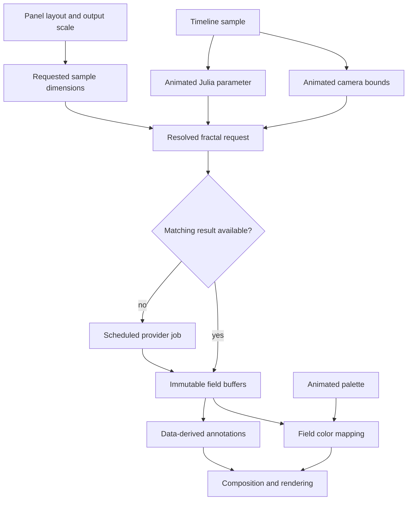

# Data sources, on-demand computation, and Fortran

Status: proposed design, 2026-10-26. Interfaces below are illustrative. The implemented subset supports a deterministic synthetic scalar field, validated binary saved results, content/provenance identity, reload reuse, baking, and saved-only replay. The actual Fortran routine, foreign workers, asynchronous scheduling, animated numerical requests, and range preparation remain unimplemented. See [current commands](../README.md) and [verification](verification.md).

## Decision proposed

Support both callable computation and saved data from the beginning. A source request describes the result needed; an execution policy determines whether that result is read, computed, or prepared ahead of time.

The author has an existing Fortran Mandelbrot/Julia computation subroutine and a separate file-writing subroutine. The computation should be callable without invoking the writer. A worker adapter can expose it while preserving the numerical implementation.

Data is allowed to depend on visual properties. An animated camera may determine the fractal domain, a panel's pixel size may determine the sampling resolution, and a moving marker may determine a probe position. These dependencies belong in the scene's evaluation graph.

## Separate three concerns

| Concern | Options | What it determines |
| --- | --- | --- |
| Source semantics | Saved samples, independent evaluator, evolving simulation | How a particular result is defined |
| Execution policy | Compute missing results, prepare a range, require saved results | When computation happens |
| Adapter | Saved-data reader, persistent process, native C ABI call | How the host obtains the result |

Avoid separate authoring models for "live" and "baked" visuals. A saved result and an on-demand result expose the same typed channels and coordinates.

### Source semantics

An **independent evaluator** computes a result from a complete parameter set. Ordinary Mandelbrot/Julia field evaluation fits this model if the existing implementation has no relevant hidden mutable state. Each complex orbit iterates internally, but requesting an image does not require requesting the previous video frame.

An **evolving simulation** derives state from previous simulation steps. Its adapter owns initial conditions, fixed step size, input history, and checkpoint/replay behavior. A request for simulation time must be answerable independently of the sequence of preview frame requests. Bake a full run if replay is too expensive.

A **saved-data source** samples immutable fields, time series, events, or geometry. It specifies interpolation and correspondence explicitly. Missing times do not silently acquire invented values.

External nondeterministic streams are a later capture feature: record timestamped inputs/results and replay that recording for reproducible output. They should not implicitly acquire the guarantees of independent evaluators.

## Evaluation as a graph



There is no universal rule that all data precedes all layout. Measurement, source requests, signals, and data-derived visuals are dependency nodes. The scheduler runs ready nodes and waits only where required.

For example, a field may depend on a panel's dimensions while a fixed-size label depends on the field's statistics. This is valid if neither result feeds back into the panel dimensions. If panel dimensions depend on those same statistics, the graph contains a cycle. Report the dependency chain; require an explicit fixed extent, previous recorded state, or a separately defined iterative computation to break it.

Providers run outside the drawing loop and UI event handler. Cache hits resolve quickly; misses create asynchronous work. The drawing stage receives ready immutable buffers or clearly marked preview substitutes.

### Illustrative authoring

```tsx
const plane = viewport({
  bounds: animatedBounds,
  size: [1920, 1080],
});

const field = source("fortran-fractal").evaluate({
  family: "julia",
  juliaC: animatedC,
  bounds: plane.bounds,
  resolution: plane.pixelSize,
  maxIterations: 2000,
  precision: "f64",
});

return (
  <Field2D
    view={plane}
    values={field.channel("smoothEscape")}
    status={field.channel("escapeStatus")}
    palette={animatedPalette}
  />
);
```

Here `evaluate` constructs a source node. It does not synchronously run Fortran while the TSX function executes. Its parameter signals resolve at the requested timeline sample; the host then obtains the result.

The provider ID is configured with its executable or adapter in project configuration. Visual code refers to its declared input/output schema. The source API should not require visual authors to write process management or FFI code.

## Request and result contracts

A request carries:

- Provider ID, interface version, and a fingerprint of the numerical build/configuration.
- Resolved numerical parameters and referenced input content hashes.
- Domain coordinates, sampling convention, and required output channels.
- Sampling resolution, iteration/tolerance requirements, and precision policy.
- Simulation time, initial conditions/history ID, and seed where they affect the result.
- A job ID and scheduling metadata such as preview priority and cancellation.

Scheduling metadata does not affect numerical identity. Actual quality settings do. Wall-clock time or frame number should not enter the numerical cache key unless they are genuine source inputs.

For example, the resolved numerical portion of a Julia request could be:

```json
{
  "provider": "fortran-fractal",
  "parameters": {
    "family": "julia",
    "c": { "real": -0.8, "imaginary": 0.156 },
    "bounds": { "xMin": -2, "xMax": 2, "yMin": -1.125, "yMax": 1.125 },
    "resolution": { "width": 1920, "height": 1080 },
    "maxIterations": 2000,
    "precision": "f64",
    "sampling": "pixel-centers"
  },
  "channels": ["smoothEscape", "escapeStatus"]
}
```

The scheduler adds interface/build identity and job metadata. The binary32 scalar channel can be described with shape `[1080, 1920]`, axes `["y", "x"]`, and byte strides `[7680, 4]`. Its coordinate map states whether the first row samples near `yMax` or `yMin`. This avoids relying on a reader's implicit image/array convention.

A result carries:

- Immutable typed channels: scalar field, vectors, points, polyline buffers, indexed geometry, or table columns.
- Dtype, shape, byte strides, byte order, offsets, and buffer lengths.
- Axis names and orientation, domain bounds or sample coordinates, units, and pixel-center/edge conventions.
- Validity/status information and optional numerical diagnostics.
- Request provenance, actual quality/precision, and content hashes.
- Storage handles with explicit ownership and lifetime rules.

Start with dense scalar fields and small point/line datasets. Generalize from working examples instead of implementing every possible scientific data structure immediately.

Preserve dimensional metadata for future mixed 2D/3D views. A PDE result may be a 2D grid shown as either a heatmap or a height field, a vector field shown as arrows/curves, or a 3D grid shown through slices. Record axes, spacing or explicit coordinates, topology, and whether values belong to vertices or cells. Rendering choices should not be baked into the numerical provider. Full volume rendering and isosurface extraction remain later features; see [mixed scene targets](mixed-scenes.md).

Use JSON for control messages and descriptors. Store dense arrays as binary payloads, never arrays of JSON numbers or base64 blobs in the per-frame path. For a first local worker, JSON lines plus immutable binary result files are easy to inspect and cache. Memory mapping or framed binary transport can replace the bulk-data path without changing the source schema.

Publish cache entries only after payloads and metadata are complete. Validate lengths, types, and strides before creating views. Keep buffers alive through upload/consumption, and never reuse a worker output allocation while a reader still holds it.

## Fractal-specific output

Prefer numerical fields to final RGB images when the solver makes them available:

| Channel | Purpose |
| --- | --- |
| Smooth escape value | Flexible color mapping and palette animation |
| Iteration count | Diagnostics and alternative mappings |
| Escape status | Distinguish escaped samples from iteration-limited or invalid samples |
| Optional distance estimate or orbit-trap metric | Additional visual effects when supported by the algorithm |

These channels are candidates, not assumptions about the existing routine. An RGB output adapter remains useful as an initial fallback.

Changing a palette, title, annotation, or overlay should reuse the same numerical field. Changing bounds, Julia parameter, iteration limit, precision, or sample resolution generally requires a new evaluation. A camera move may display a transformed cached field for immediate preview, but final output must obtain samples meeting its requested domain/resolution.

Blending fields for two Julia parameters is a visual transition, not a substitute for evaluating the fractal at an intermediate parameter. Any such approximation must be explicit.

Iteration-limited samples are not automatically proven members of the set. Preserve the solver's status instead of collapsing all non-escaped values into a mathematical membership claim.

Computational precision and display-channel precision are separate. Deep zoom coordinates may need more than binary64 even when smooth escape values can be displayed as binary32. Keep precision explicit, and allow exact string or multiword coordinate encodings in a later high-precision adapter; do not route such coordinates through JavaScript `number`. The initial adapter must reject precision modes it cannot implement.

## Cache, preview, and baking

Proposed policies:

| Policy | Behavior | Use |
| --- | --- | --- |
| On demand | Reuse matching results; compute missing requests | Interactive authoring |
| Prepare range | Evaluate the scene over a selected sample range and fill missing results | Smooth playback and export preparation |
| Require saved | Fail with a missing-request diagnostic rather than start computation | Predictable replay and portable export |

These are scheduling policies over the same request contract. Baking a timeline needs the source requests induced by its animated visuals; saving arbitrary numerical snapshots is not sufficient when the visualization changes source parameters.

Key a numerical result by provider build/configuration, resolved numerical inputs, upstream content hashes, and concrete quality/precision settings. Preserve exact values; do not silently round or quantize camera coordinates to improve cache hits. Record relevant compiler flags/backend settings in the build fingerprint. A provider must declare the reproducibility it can support.

Separate numerical caching from visual caching. A palette edit invalidates color mapping, not the underlying numerical field. Reusing a higher-quality result for a lower-quality request requires an explicit compatible derivation; a draft result never satisfies a final request merely because its bounds match.

While scrubbing, prioritize the newest request, deduplicate identical jobs, bound queues and resident buffers, and discard obsolete completions from the displayed frame. Providers advertise supported cancellation points and concurrency. Canceling a request does not guarantee an arbitrary foreign subroutine can be interrupted safely.

Preview can request fewer samples or iterations and then refine. This is intentionally approximate output with explicit status. Final export waits for each required final-quality result and never silently records a stale or draft field. A full pre-bake is optional; computation and rendering can also be pipelined.

A prepared bundle can include a manifest of scene/configuration identity, provider fingerprints, exact requests, and result hashes. It permits replay without the Fortran toolchain only when every required request is present.

Caching cannot make a new expensive request cheap. Measure solver time separately from scheduling, transport, upload, compositing, and encoding. A long fractal zoom may still be dominated by numerical work.

## Fortran integration

Use a small `ISO_C_BINDING` wrapper with `BIND(C)` around the existing computation subroutine. Rust calls the resulting C ABI. The wrapper adapts types and ownership; it does not replace the numerical algorithm. GNU Fortran documents `BIND(C)` and `VALUE` for interoperable procedure arguments: [procedure interoperability](https://gcc.gnu.org/onlinedocs/gfortran/Interoperable-Subroutines-and-Functions.html).

Prefer explicit C-sized integers, `c_float`/`c_double`, real/imaginary scalar pairs, and contiguous caller-owned output buffers. Pass lengths and dimensions explicitly, return an error status, and keep compiler-specific array descriptors and Fortran character strings inside the wrapper. Map internal errors to returned diagnostics where possible. Include the required Fortran runtime libraries in the worker's build/deployment.

Fortran is column-major, but a field declared `values(width, height)` has x as the first, contiguous index. It can match an x-fastest image buffer with Rust offset `y * width + x` without a transpose. This depends on the routine's actual declaration and axis convention. If it uses `values(height, width)`, describe its strides or convert deliberately. Source: [Fortran/C array interoperability](https://gcc.gnu.org/onlinedocs/gfortran/Interoperability-with-C.html).

The boundary must specify who allocates and frees buffers, whether pointers may be retained, whether the routine uses shared module state, and how many concurrent calls are allowed. Default to one active call until reentrancy is established. Account for OpenMP threads when sizing a worker pool.

### Recommended first adapter

```text
Rust source scheduler
    → persistent local worker: request metadata and binary-result handles
        → Rust/C-compatible glue
            → Fortran BIND(C) wrapper
                → existing numerical subroutine
```

A persistent worker avoids starting a process for every sample and separates provider rebuilds from the compositor. It also contains process-wide exits or foreign-code failures. The existing writer can remain available for the author's own workflow; the adapter uses the common result/cache format.

An in-process C ABI adapter is an optional optimization after measuring transport costs. It exposes the renderer process to the routine's threading, blocking, and failure behavior. Keep the logical request/result contract identical so the scene does not change when choosing an adapter.

Start with ordinary CPU buffers. GPU-resident foreign buffers require backend-specific sharing and synchronization; a C pointer does not automatically become a portable zero-copy graphics resource.

## First experiment and verification

The first end-to-end experiment should call the existing routine for two Julia parameters, display its numerical output with a palette, animate the parameter and camera, cache results, and replay the same range with computation disabled. A palette-only edit should leave numerical cache entries reusable.

An isolated probe on this development machine successfully compiled a Fortran `BIND(C)` function and called it from Rust. A Fortran `(3, 2)` field produced the expected x-fastest sequence `[11, 12, 13, 21, 22, 23]` in a caller-owned binary32 buffer. This verifies the basic ABI and layout approach; it does not test the author's routine, worker protocol, rendering, or numerical performance. Probe artifacts were kept under `/tmp`, outside the project.

Before implementing the adapter against the real routine, inspect its arguments, allocation/layout, compiler, precision, threading, and current output channels. The main source and rendering design can proceed independently of those details.
