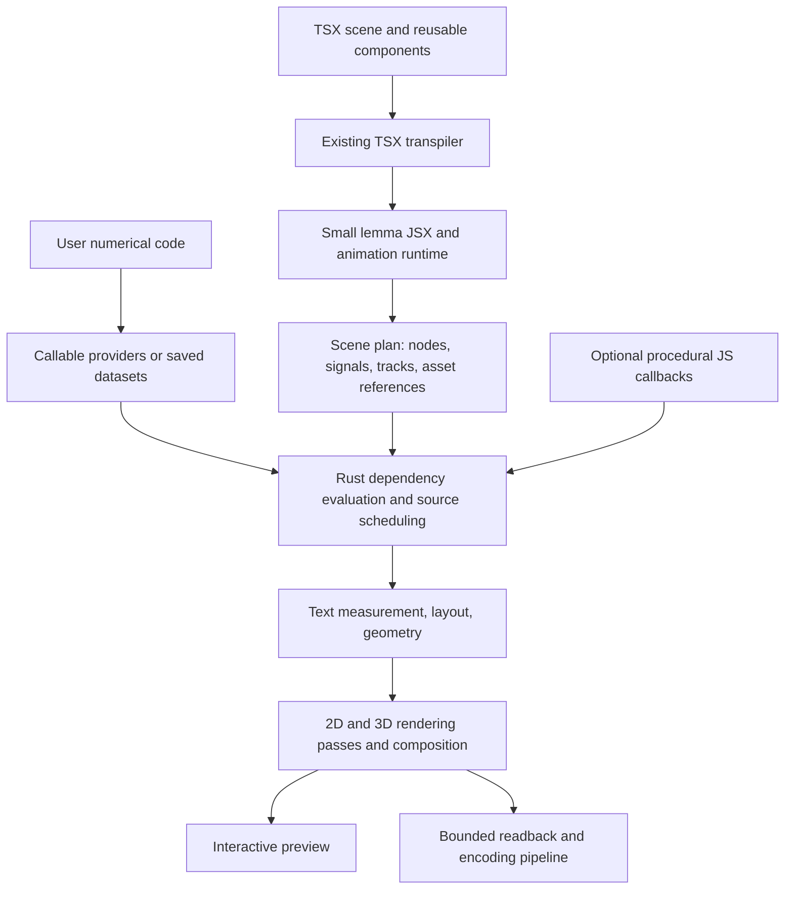

# lemma-rs: initial design proposal

Status: working proposal for discussion, 2026-10-26. API examples are sketches, not implemented interfaces.

Follow-up proposals: [data sources and Fortran integration](data-sources.md), [rendering library comparison](rendering.md), [mixed 2D and 3D targets](mixed-scenes.md), [six-reference feasibility analysis](reference-feasibility.md).

Current scope consolidation: [one initial rendering target](rendering-target.md), combining the first curve, sampled-field, and 2D composition experiments in one scene.

Next code work: [implementation design](implementation.md), specifying the first frame renderer, scene/evaluation boundaries, authoring loop, and numerical integration.

## Product direction

Build a general motion graphics engine with a Rust core. Math, scientific visualization, and algorithm explainers should be strong applications of its primitives. They should not determine the limits of its visual language.

Mixed 2D and 3D storytelling is a planned capability. The first Fortran fractal project can remain 2D, and full 3D support is not a requirement for its delivery. Renderer selection must nevertheless account for scientific surfaces, spatial diagrams, camera motion, and 2D annotations or planes within 3D views. Swaptube's 3D is the functional reference; ScienceClic is an art-direction reference supplied by the author.

The central workflow is:

1. The author writes numerical or domain code in their preferred environment.
2. That code exposes data, a trace, or sampled results.
3. An agent writes a visualization using a small, familiar visual API.
4. The author and agent iterate through previews, screenshots, and precise edits.
5. The same scene and evaluation rules produce the final video.

Success means an author can say "follow this particle, reveal these trajectories, then turn the plot into a title card" without hand-building visualization infrastructure.

Confirmed priorities:

- General motion graphics and mathematical visualization both matter from the beginning.
- Preserve a practical path to mixed 2D and 3D scenes; the first project does not require 3D.
- The engine should support polished typography, composition, layout, and effects alongside data graphics.
- The author wants to own their numerics and delegate much of the visual code to an agent.
- JSX is an attractive authoring surface. Full React compatibility is not an established requirement.
- Swaptube's data and animation architecture is an inspiration; Remotion's authoring experience is another.

## What to borrow

Swaptube separates domain objects such as graphs from scene classes, and its `StateManager` represents numerical relationships as a directed acyclic graph. Its transitions can blend expressions over narration or visual blocks. These are useful ideas to retain in a more typed, inspectable model. Sources: [Graph.h](https://github.com/2swap/swaptube/blob/master/src/DataObjects/Graph.h), [StateManager.h](https://github.com/2swap/swaptube/blob/master/src/Core/State/StateManager.h), [StateManager.cpp](https://github.com/2swap/swaptube/blob/master/src/Core/State/StateManager.cpp).

Swaptube's narration blocks also suggest a valuable optional authoring layer: an animation can occupy a sentence or a fraction of that sentence without embedding absolute timestamps throughout a project. Source: [Swaptube README](https://github.com/2swap/swaptube/blob/master/README.md).

Remotion's frame-based component model provides another useful contract: visuals should be reproducible when frames are requested in any order. This is the basis for reliable seeking and independent frame evaluation. Sources: [core idea](https://www.remotion.dev/docs/idea), [deterministic rendering guidance](https://www.remotion.dev/docs/flickering).

Performance comparisons must use current implementations. Remotion supports overlapping rendering and encoding, shared-memory bitmap capture on supported platforms, and a separate browser-side rendering path. Avoid benchmarking only an older screenshot-to-PNG pipeline. Sources: [parallel encoding](https://convert.remotion.dev/docs/parallel-encoding), [client-side rendering](https://www.remotion.dev/docs/client-side-rendering).

## Proposed architecture



JSX describes the visual structure. Ordinary functions create reusable components. Animation helpers construct data describing time-dependent values. Rust evaluates that data, resolves layout, and renders.

The diagram expresses responsibilities, not a commitment to separate processes or crates. Start with a small vertical implementation. Keep a narrow renderer interface and a versioned scene schema; defer a general plugin system.

### JSX without a new language compiler

Use an existing TSX toolchain, initially esbuild or TypeScript, with a custom JSX import source. JSX becomes calls into our runtime; that runtime creates scene descriptions. TypeScript documents the `jsx-runtime` entry points and `jsxImportSource` mechanism, and esbuild supports the corresponding transform. Sources: [TypeScript JSX](https://www.typescriptlang.org/docs/handbook/jsx.html), [esbuild JSX](https://esbuild.github.io/content-types/#jsx).

There are three different kinds of work here:

| Layer | Responsibility | Initial approach |
| --- | --- | --- |
| Syntax transform | Turn TSX into JavaScript | Existing toolchain |
| Authoring runtime | Components, animation helpers, validation | Small library we implement |
| Scene plan | Tell Rust what exists and how it varies over time | Explicit data schema we implement |

The scene plan is an intermediate representation, but it does not need to represent arbitrary TypeScript or require a new source compiler. JavaScript executes ordinary authoring logic and constructs the plan.

A custom JSX runtime does not automatically support React hooks, DOM nodes, CSS, or existing React components. Start with function components and explicit animation values. Revisit React integration only if real authoring examples need it.

### Two ways to express animation

The main path describes animation once: keyframes, easing, analytic springs, paths, repeat, stagger, and relationships between properties become nodes in the plan. Rust evaluates these at the requested time.

Provide a procedural escape hatch for visual logic that is awkward to express with built-in operations. A JavaScript callback receives explicit frame context and emits batched property or geometry updates. It remains JavaScript and runs when frames are evaluated; its cost should be visible in profiling.

Do not promise to translate arbitrary closures into Rust or GPU shaders. Arbitrary callbacks are not serializable, require their host runtime, and must obey the same reproducibility rules as other frame logic. A frame with a callback is evaluated by the host plus engine together.

Use common built-ins for the easy path, and keep custom behavior possible. Add new signal operations when actual projects expose repeated needs.

## Core data model

Keep these concepts separate:

| Concept | Meaning | Examples |
| --- | --- | --- |
| Domain data | Results independent of presentation | Numerical samples, graph topology, solver output, algorithm events |
| Data source | A request for a typed result, resolved through an adapter or saved data | A Fortran fractal evaluator driven by camera bounds |
| Visual node | Something that contributes to a composition | Group, text, path, image, point cloud, layer |
| Property | An addressable value on a node | Position, opacity, path reveal, fill, camera scale |
| Signal | A typed value derived from time or other values | A trajectory sample, another node's position plus an offset |
| Track | Scheduled changes to a property | Keyframes, a fade, a sequence of moves |
| Clip | A local timeline with a duration | Reusable entrance, scene section, narration segment |
| Asset | An identified external resource | Font, image, numeric buffer, audio, baked simulation |

Give nodes and properties stable IDs and optional human-readable names. Keep source locations from authoring where practical. An error should identify `trajectory-label.position` and its component, rather than an anonymous renderer index.

Domain data must support multiple views. A graph can drive a node-link diagram, adjacency matrix, or animated edge list without copying its algorithm implementation into each visual component.

Scalar numeric signals are not enough. The model needs numbers, vectors, colors, transforms, and discrete values. Different types have explicit interpolation rules; strings and object identities do not silently interpolate. General path morphing requires compatible geometry or an explicit correspondence strategy.

Bindings form a dependency graph checked before rendering. Compile built-in operations into an evaluation order and resolve property references once. Track which inputs affect geometry, text measurement, layout, and compositing so that an opacity animation does not force text shaping.

Layout introduces additional dependencies: a node can depend on measured text size, and a label can follow a transformed point. Define the measurement/layout/transform stages explicitly and reject unsupported cycles. Do not quietly turn the signal graph into an unrestricted constraint solver.

## Numerical code and dense data

Support callable providers and saved datasets through one source contract. Visual properties such as camera bounds, a moving probe, or panel resolution can drive source requests. A bake pass resolves requests ahead of time; ordinary preview resolves missing requests on demand. Both modes produce immutable results consumed by the same visual nodes. See [the source proposal](data-sources.md).

Use JSON for request metadata and small datasets, and binary buffers for dense results. Metadata describes fields, types, shapes, strides, units, coordinate conventions, and sample times. Large arrays should be loaded by the Rust engine and referenced by the scene plan. Avoid serializing every point across the language boundary on every frame.

Dense primitives such as point clouds, polylines, and sampled fields need bulk data inputs. A million particles should not require a million JSX components. High-level plotting components can lower into a handful of bulk drawing operations.

Numerical traces should preserve stable element IDs where correspondence matters. For changing topology or algorithm states, consume timestamped events or immutable snapshots with a documented interpolation policy. A view should not rerun the author's entire algorithm every time the playhead moves.

The first concrete numerical integration is the author's existing Fortran Mandelbrot/Julia subroutine, whose computation is already separable from its file writer. A small C ABI wrapper can expose the subroutine to a persistent worker. Saved-data and direct native adapters use the same logical result contract. Do not require numerical code to be rewritten in Rust or JavaScript.

## Animation semantics

The primary evaluation contract is:

```text
visual state = evaluate(scene plan, assets, source results for resolved requests,
                        input parameters, sample time, seed)
```

Within a pinned environment, requesting the same sample must produce the same visual state regardless of seek history. Exact pixels across different GPUs, drivers, or encoders are a separate guarantee and are not assumed.

Proposed rules:

- Store output frame rate as a rational value and use integer frame indices. Derive sample time without cumulative floating-point stepping. Support exact clip and audio timing before converting values for interpolation.
- A clip maps global time to local time. Sequence, overlap, delay, repeat, and time scaling use this one mapping model.
- A property has an initial value and either a track or a binding. Mixing them requires an explicit composition or override operation.
- A normal tween captures its source at the start, reaches its target at the end, and holds the final value. Overlapping writes to the same property are errors unless their composition is explicit.
- Blending two live signals is a separate operation. Both expressions can continue changing during the blend, preserving the useful part of Swaptube's expression transitions.
- Define clip intervals as half-open. Track endpoints clamp to their final value; specify how this interacts with a clip ending before an output sample lands exactly on its endpoint.
- Built-in random values use a seed plus stable identity or sample coordinates. They do not depend on evaluation order.
- Springs use an analytic evaluator or precomputed samples. Stateful providers use fixed steps and explicit replay/checkpoints, with optional full baking.
- Seeking requests a specific state or parameterized result. It does not advance a hidden simulation once per displayed frame.
- Source requests are dependency nodes, including when their parameters depend on visual properties. Schedule them outside drawing and await the required results before drawing a final frame. Full-video baking is optional. Missing assets produce actionable errors; preview placeholders must be identified as placeholders.

Sequential authoring remains useful: a helper can record "play, wait, play" into tracks during scene construction. It must not render frames as it records instructions.

Narration can become a clip adapter: audio duration and cue markers determine timing, while the animation system remains general. Defer automatic alignment and recording tools until the ordinary timeline works.

## What authoring could look like

Illustrative TSX, with names and exact conventions still open:

```tsx
import { Composition, Group, Text, Circle, tween } from "lemma";

function Intro() {
  const enter = tween({
    from: 80, to: 0, start: 0, duration: 0.8, ease: "cubicOut",
  });

  return (
    <Composition width={1920} height={1080} duration={4} fps={60}>
      <Group x={960} y={540}>
        <Text y={enter} fontSize={96} fill="#f4f4f5">
          Order from chaos
        </Text>
        <Circle x={-320} y={140} radius={18} fill="#8b5cf6" />
      </Group>
    </Composition>
  );
}

export default Intro;
```

Here `enter` is an animation description, not a number calculated from a hidden clock. The authoring runtime puts that description into the scene plan. No arbitrary source analysis is required.

A data visualization might consume a dataset through a reusable component such as `<Trajectories data={results} />`. That component should use the same text, paths, masks, layers, cameras, and timing tools as a product animation. Its bulk geometry path should remain efficient.

Decide coordinate conventions, text anchors, and unit types before stabilizing this API. The sketch uses pixel positions and seconds only to make the idea readable.

## Visual capabilities and rendering

The initial capability set should establish a useful visual language:

- Groups, transforms, 2D cameras, explicit drawing order, and isolated layers.
- Rectangles, circles, vector paths, fills, strokes, gradients, and path reveal.
- Text shaping, line breaking, consistent font loading, and explicit text anchors.
- Pre-typeset mathematical assets with explicit placement and color, including use on world-space planes in the mixed-scene experiment.
- Stack/row/column layout, alignment, spacing, and absolute positioning.
- Images, clipping, masks, group opacity, and a defined initial set of blend modes.
- A focused set of shadows and blur effects, with their cost visible.
- Dense polylines and point clouds driven by datasets.
- Keyframes, easing, springs, sequencing, overlap, stagger, and property bindings.

Build math conveniences on this foundation: axes, plots, labels, graph diagrams, and later equation imports and semantic equation transitions. Scientific 3D is a planned extension with explicit scene, camera, and GPU-resource contracts, described in [mixed scene targets](mixed-scenes.md). A small integration proof should precede a final backend decision, even though the first fractal deliverable remains 2D. Broad cinematic rendering, arbitrary HTML/CSS compatibility, and arbitrary topology morphing remain outside the first implementation.

Use an established renderer. The first spike should compare Vello GPU with Skia through Rust bindings on our actual scenes, including text, masks, blur, and headless output. Vello's current GPU renderer uses CPU preprocessing with GPU rasterization/compositing; its experimental compute renderer is a different implementation. Sources: [Vello architecture](https://github.com/linebender/vello/blob/main/ARCHITECTURE.md), [Vello renderer selection](https://github.com/linebender/vello/blob/main/README.md). Rust-Skia provides bindings to Skia including several GPU backends, with a native dependency/build tradeoff. Source: [Rust-Skia](https://github.com/rust-skia/rust-skia).

Choose one stack after the spike. The [current comparison](rendering.md) now favors evaluating a shared wgpu foundation, a 2D drawing module such as Vello, and a focused scientific 3D path. The earlier Skia-first recommendation addressed 2D composition alone and is insufficient to settle this broader target. Skia remains a possible 2D module if resource sharing is demonstrated. Vello GPU's documented effect gaps still matter. These are recommendations, not adopted dependencies; compare mixed-scene integration as well as 2D quality and performance.

Define a color and alpha contract at the backend boundary, initially SDR sRGB assets/output with explicit premultiplication rules and documented interpolation/compositing behavior. Verify gradients, transparency, and encoded video visually. Export quality includes these details, antialiasing, and font metrics.

Preview and export should share evaluation, layout, assets, and rendering. Reduced preview resolution is allowed; different animation semantics are not.

## Making it easy for an agent to use

The public API should favor familiar components, small examples, predictable defaults, and precise errors. Avoid requiring agents to write a renderer, rebuild a dependency graph by hand, or understand ownership lifetimes to move a label.

The development loop should offer:

- A watcher that rebuilds the TSX scene and restores the current playhead time after a successful edit.
- An interactive preview with seek, pause, loop range, and frame stepping.
- A headless command to render a specific frame or short range.
- Machine-readable scene inspection: node bounds, resolved properties, asset errors, and timing.
- Useful diagnostics for cycles, conflicting tracks, invalid data shapes, unsupported operations, and missing fonts.
- Canonical examples for typography, animated layouts, data graphics, and composition.

Fast rebuilding of the scene plan is sufficient initially. Preserving JavaScript runtime state through edits is not a prerequisite for a productive preview loop.

## Performance contract

No speed multiplier is claimed before measurement. Measure authoring feedback and final export separately.

| Metric | Why it matters |
| --- | --- |
| Cold launch and first frame | Getting started and short jobs |
| Edit-to-preview latency | How quickly an agent or author can iterate |
| Seek latency and preview frame time | Inspecting and adjusting animation |
| Plan evaluation and layout time | Whether authored complexity scales |
| Render and readback time | GPU throughput and synchronization costs |
| Encode and end-to-end export time | Actual delivery speed |
| Peak CPU/GPU memory | Long scenes and dense datasets |

Start with these architectural constraints:

- Parse, validate, and resolve references outside the frame loop.
- Reuse geometry, glyph data, assets, and bounded intermediate buffers.
- Cache layout based on its real inputs. Moving a fixed text run should not reshape it.
- Batch dense geometry and minimize host/native crossings.
- Preserve painter's order and blend correctness when batching.
- Pipeline evaluation, rendering, readback, and encoding with bounded queues and backpressure.
- Stream frames to the encoder instead of requiring an image sequence on disk.
- Optimize independent frame work selectively; more concurrent GPU submissions are not automatically faster.
- Defer platform-specific zero-copy encoder integration until profiling justifies it.

At 1920 × 1080, 60 fps, and four bytes per pixel, raw frame output alone is about 498 MB/s. GPU acceleration does not remove readback, format conversion, or encoder costs.

Benchmark matched scenes on the same machine with recorded versions, resolution, quality, codecs, and encoder settings. Report cold and warm timings; isolate renderer throughput from total export time. Use dense-data scenes as well as typography/effect-heavy scenes. Compare visual quality alongside time.

## First implementation sequence

1. **Agree on the authoring experience.** Write representative TSX examples for a motion piece and a numerical visualization. Resolve signal versus callback ergonomics, coordinate conventions, and component composition. Treat examples as design tests before freezing interfaces.
2. **Prove one vertical path.** Existing TSX transform → small JSX runtime → versioned JSON plan → Rust → one rendered frame. Support a group, shape, text, and tween, plus a tiny numerical dataset. Validate that a procedural callback can send a batched update through the same property model.
3. **Choose the rendering stack with evidence.** Build the [consolidated acceptance scene](rendering-target.md) incrementally: curve/markers, sampled plane/surface, then mixed 2D graphics and annotations. Verify curve/text quality, occlusion, GPU resource sharing, and deployment/build friction. Select one stack and document missing features rather than hiding unsupported effects.
4. **Make iteration useful.** Add a watcher, native preview, frame/range rendering, and scene inspection. Exercise direct seeking and frame-order independence early.
5. **Deliver two short videos.** One typography/layout/effects motion piece and one dense-data visualization. Both should use reusable components, smooth animation, and the same engine. Add FFmpeg export and basic audio placement.
6. **Expand where the examples demand it.** Add richer data adapters, semantic helpers, narration clips, and extension points based on measured needs.

For the first TSX-to-Rust spike, use a long-lived Rust process with a small protocol and JSON plans. This keeps the engine runnable independently and lets scene reloads avoid recompiling Rust. Use a simple transport first; profile it before choosing a native Node binding or binary protocol. Keep large-buffer and per-frame callback transport costs explicit.

Acceptance criteria for the first two videos:

- A generated visualization can use numerical results without embedding the numerical implementation in visual code.
- A scene component can be reused with different data and visual parameters.
- Sequential and shuffled frame requests resolve to the same visual state; repeated frame renders agree in the same pinned environment.
- Font loading, layout, masks, and effects are consistent between preview and export.
- Typical visual edits rebuild the authoring layer without a Rust rebuild.
- Performance reports separate evaluation, layout, drawing, readback, and encoding.
- Unsupported operations fail clearly before a long export.

Tests should protect these contracts: frame-order independence, timeline boundaries, binding cycles, track conflicts, data-shape validation, and representative image comparisons. Do not spend the first milestone building an enormous generic test framework.

## Open decisions

- Does the first JSX surface use only explicit animation descriptions, or expose a per-frame callback immediately? The proposal proves the callback boundary early but keeps most examples on built-ins.
- Which animation and layout conventions are easiest for an agent to generate reliably? Test complete examples rather than deciding from names alone.
- Which renderer covers the intended visual language with acceptable build and runtime costs?
- The initial platform is the author's NixOS laptop: NVIDIA RTX 4070 Mobile for performance, AMD integrated graphics for compatibility. Validate both through the [adapter selection and benchmark plan](implementation.md#hardware-and-adapter-selection); broader platform support remains open.
- Validate the proposed persistent-worker, binary-buffer, and C ABI source integration against the author's Fortran code and its precision requirements.
- Determine the first scientific 3D implementation: a focused wgpu module or an integrated renderer such as Bevy, with mixed-scene correctness and frame-independent evaluation verified.

These are proposals for iteration. JSX authoring, the runtime process boundary, backend choice, and exact API names remain reversible until the first end-to-end examples establish their value.
