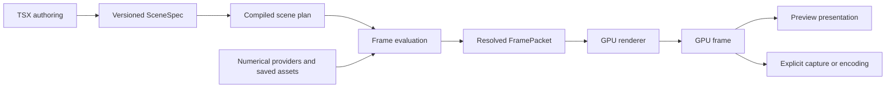

# Implementing the first scene

Status: implementation design, 2026-10-26. The initial rendering target is agreed and a working vertical slice now exists. This document preserves the architectural plan and completion criteria; [the README](../README.md), [verification record](verification.md), and [development log](development-log.md) describe current commands, completed work, and limitations. Illustrative interfaces below are design context, not additional supported APIs.

## First implementation decision

Start with a Rust library and a small headless CLI, using wgpu for the rendering experiment. Keep one crate with clear module boundaries until a working frame justifies splitting packages. Use a focused path/mesh implementation for the first curve, markers, and surface. Evaluate Vello when adding the general 2D drawing module; the shared device/resource contract must work before treating that module as selected.

This does not settle a permanent custom 3D renderer versus an existing rendering engine. The agreed scene is the comparison workload. The small first slice establishes interfaces and concrete integration costs.

The first milestone is a command that renders a selected frame of the scene to a PNG. This command is now runnable (adapter selection and environment setup are described in the README):

```sh
cargo run --release --bin lemma -- render-frame \
  --scene reference --frame 90 --fps 60 --size 1280x720 --output out/frame-0090.png
```

## Four boundaries



1. **SceneSpec:** serializable intent: assets, nodes, cameras, signals, tracks, and source requests. This is the TSX/Rust boundary.
2. **CompiledPlan:** validated references, graph order, types, resource identities, and relevant dependency information. This is rebuilt when scene structure changes, not for every output frame.
3. **FramePacket:** resolved camera/object values and draw/resource references for a particular sample. It contains no unresolved provider jobs or arbitrary JavaScript closures.
4. **GpuFrame:** rendered GPU resources and completion information. Presentation can consume them without readback; capture/encoding requests the transfer it actually needs.

The numerical resolver and evaluator may wait asynchronously. The drawing stage receives ready resources. Measurement, data-derived properties, and source requests are scheduled by their dependencies; the diagram does not impose a rule that all data must precede all layout.

An illustrative host flow is:

```rust
let plan = compile(scene_spec)?;
let packet = evaluator.resolve(&plan, sample).await?;
let gpu_frame = renderer.render(&packet)?;
let pixels = capture.read_rgba8(&gpu_frame).await?;
```

These names describe boundaries, not a frozen public API. Start the renderer experiment with a small Rust scene fixture that produces a packet, then introduce the serializable spec and compiler. Do not build a general expression compiler before validating camera, strokes, depth, and resource handling.

## Initial code layout

```text
Cargo.toml
src/
  lib.rs
  time.rs                 rational frame rate and explicit samples
  scene.rs                SceneSpec and stable author-facing IDs
  eval.rs                 compilation/evaluation and FramePacket
  data.rs                 immutable arrays, channel metadata, resource identity
  source.rs               source requests, resolution, cache keys
  render/
    mod.rs                renderer entry point and GPU frame
    gpu.rs                device, queue, targets, formats, capabilities
    resources.rs          buffer/texture caches and allocation ownership
    paths.rs              spatial strokes, gradients, reveal
    meshes.rs             indexed meshes and instance data
    graphics.rs           2D drawing adapter and spatial graphics planes
    compose.rs            pass scheduling, overlays, optional effects
    capture.rs            readback layout and frame output
    shaders/
  bin/
    lemma.rs              diagnostic CLI
examples/
  reference_scene.rs      the agreed scene, built incrementally
```

Create modules when their first working slice needs them; the tree is an ownership map, not a request to populate empty abstractions. Only `render` imports wgpu types. Source providers and the authoring schema do not expose backend resource handles.

## Dependencies and version policy

- **wgpu:** device/queue, GPU buffers, textures, pipelines, and submission.
- **glam:** vector, matrix, and quaternion math internally. Keep wire formats as explicit arrays/fields.
- **bytemuck:** checked plain-data layouts for GPU uploads; keep shader alignment explicit.
- **png:** diagnostic still output.
- **serde/serde_json:** the authoring/process schema when that boundary is introduced.
- **winit:** native preview when headless frames work.
- **Vello, Parley, Taffy:** add after their drawing, text, and layout responsibilities are exercised by the scene. Do not treat a glyph renderer as a complete text/layout system.

Use published compatible versions and commit the lockfile when code lands. The inspected Vello main-branch manifest currently uses wgpu 30; that establishes a possible compatibility line, not proof that every matching Vello package is published. Verify the chosen release/API and avoid independently selecting incompatible wgpu versions for modules sharing textures. Sources: [Vello workspace manifest](https://github.com/linebender/vello/blob/main/Cargo.toml), [wgpu](https://docs.rs/wgpu/latest/wgpu/), [glam](https://docs.rs/glam/latest/glam/), [png](https://docs.rs/png/latest/png/).

## Time, spaces, and resources

Time enters as an integer frame index and rational frame rate. Derive sample time from that pair rather than advancing a stored clock. Preview wall time selects a requested sample; it does not determine scene semantics. Add explicit subframe samples when motion blur needs them. Stateful numerics retain their own fixed-step/replay contract.

Proposed initial rendering conventions are right-handed world coordinates with Y up, cameras looking along local negative Z, GPU depth in `[0, 1]`, and screen/layout coordinates in pixels with a top-left origin. Data coordinates remain described by their source metadata and an explicit data-to-world mapping. For a height field, mapping the two domain axes to world X/Z and value to Y is a view choice.

Assets and numerical results have immutable content identities or revisions. A frame packet refers to them through typed handles. The GPU cache retains uploaded buffers/textures across frames. Camera motion changes camera uniforms; a palette change changes palette parameters or a small lookup texture. Neither should re-upload an unchanged numerical field.

Begin with explicit conventional depth settings and document them with projection construction. Camera-relative coordinates, larger coordinate ranges, and alternative depth strategies can be introduced when a scene demonstrates the need.

## Drawing the three families

### Paths

Accept bulk sampled positions and optional color/scalar channels. Distinguish pixel-width diagram strokes from world-radius tubes in the API. The curve reference prioritizes pixel-width strokes with a sharp core.

Use triangle-based stroke geometry with explicit caps/joins, clamped sharp corners, and camera-space clipping before screen-space expansion. Handle repeated points and declared gaps. Keep raw numerical samples separate from camera-dependent tessellation, so a geometry-quality change does not automatically rerun the source computation.

Begin with a single curve and simple joins; evaluate close-up and moving-camera output before expanding the style API. Add selective glow after stroke coverage and antialiasing are sound.

### Meshes and instances

Use indexed vertex/index buffers and separate instance attributes. The first assets are a grid and simple marker geometry. Reuse the marker mesh for multiple transforms/colors; this is the same generic mechanism needed later for rigid people with force attributes.

Keep grid topology stable while field values or height scale change. Use a small palette lookup plus explicit normalization/validity. Introduce texture-driven displacement or storage-buffer access only where the field workload benefits; the public field contract should not depend on which shader representation wins.

### 2D graphics and annotations

Start with cached text/math/image assets to validate screen composition and placement in world space. Add a Vello-backed drawing adapter for paths and graphics when its shared-device rendering works. Compare line/text quality and required effect coverage rather than making an adapter choice from successful texture exchange alone.

A screen overlay uses layout coordinates. A graphics plane carries a 3D transform and participates in scene depth. A projected label uses a world anchor plus a screen-space offset/size and explicit visibility policy. Projected labels may sample scene depth on the GPU; the renderer should not read the entire depth buffer to the CPU to decide their visibility.

## GPU pass structure

The first frame needs world geometry with color/depth, antialiasing appropriate to supported target formats, and final output. Add passes as required by the scene:

1. Render opaque world meshes, markers, and supported spatial paths.
2. Render graphics planes and explicitly supported blended world content with documented depth/write rules.
3. Resolve/composite the world view and any selected-content effects.
4. Draw projected annotations and fixed screen-space graphics, applying their visibility policy.
5. Convert to the output encoding and present or capture.

One device owns the resources and submissions. Reuse pipeline and resource allocations. Choose linear working/compositing behavior and explicit sRGB output; numerical textures remain data rather than implicit color images. Intermediate formats, multisample counts, filtering, and depth sampling must be checked against adapter capabilities.

Diagnostic PNG capture can initially wait for a single frame. Reusable asynchronous staging buffers and bounded backpressure belong in the sequence/export path, before drawing export-performance conclusions. Keep capture separate so native preview does not pay for readback.

## Hardware and adapter selection

The first development platform is the author's NixOS laptop. Its RTX 4070 Mobile is the primary performance target; its AMD integrated GPU is the compatibility target. Keep the renderer on portable wgpu APIs, initially through Vulkan on this platform. NVIDIA-specific compute or encoding integrations can be optional extensions when a measured workload justifies them. They are not prerequisites for drawing or for the Fortran worker.

Add adapter enumeration and explicit selection to the diagnostic CLI in the first slice. Report adapter name, backend, driver information where available, and relevant capabilities. A high-performance preference is a default selection hint, not proof that NVIDIA was selected. An explicit selection that cannot be satisfied must fail clearly; benchmark runs must not silently substitute an integrated or software adapter. Windowed preview must also check that the selected adapter can present to its surface. Source: [wgpu adapter request options](https://docs.rs/wgpu/latest/wgpu/struct.RequestAdapterOptionsBase.html).

All drawing modules use the same selected device. Running the desktop on the integrated GPU does not require lemma's offscreen renderer to use it. Hybrid preview presentation may involve platform-managed transfers to the display GPU; avoiding CPU readback between lemma's drawing passes is a separate contract. Linux PRIME supports selectively rendering applications on NVIDIA while the desktop uses another GPU; exact setup depends on the display session. Sources: [NVIDIA PRIME render offload](https://download.nvidia.com/XFree86/Linux-x86_64/595.71.05/README/primerenderoffload.html), [NixOS NVIDIA configuration](https://wiki.nixos.org/wiki/NVIDIA#Hybrid_graphics_with_PRIME).

Benchmark the agreed scene on the existing laptop before considering new hardware. Separate adapter/driver identity, resolution, scene complexity, power conditions, and cold/warm runs in results. Measure source evaluation, upload, drawing, readback, and encoding independently. Use software Vulkan for correctness probes only; it cannot establish hardware throughput. No frame-rate or crowd-size guarantee has been measured yet.

## JSX implementation

Use an existing TSX transform and a small custom JSX runtime. Function components execute on scene load/reload and construct SceneSpec. Built-in animated values construct signal descriptions. The engine evaluates those descriptions per sample.

The first frontend should describe only the node/animation types already demonstrated by the Rust scene. This gives agents a usable authoring loop early without committing to a large schema before the drawing experiment.

Run the Rust host persistently. Initially support versioned load-scene and render-sample messages with IDs and structured errors. Send plans on successful reload, not a complete rebuilt scene for every frame. Reference large numerical assets through handles/metadata. Procedural JS frame callbacks remain a later explicit batched update path and retain their host-runtime cost.

## Fortran implementation

Keep the [source contract](data-sources.md) independent of the compositor. A persistent worker calls a small BIND(C) wrapper around the existing simulation, returns typed binary channels, and participates in on-demand caching or range preparation.

Connect this after the synthetic field/array path works. Inspect the actual routine signature, ownership, precision, axis order, and thread behavior before writing its adapter. The earlier isolated ABI probe verifies basic calling/layout only; it is not a test of the real routine.

## Build sequence and completion criteria

| Slice | Concrete result | Completion evidence |
| --- | --- | --- |
| 1: frame kernel | CLI renders a camera, spatial curve, and repeated markers at an explicit sample | Saved frame inspected; adapter/capabilities reported; useful failure if no adapter |
| 2: field and depth | Same shot adds a palette-mapped plane lifting into a surface | Correct occlusion; unchanged input buffers reused during camera/palette edits |
| 3: mixed graphics | Fixed equation/legend, projected label, world-space graphics plane | Sharp text/curves at intended scale; depth/color/alpha checked visually |
| 4: authoring loop | TSX constructs the working scene; persistent host reloads it | Visual parameter edits update the scene without recompiling Rust; errors retain the last valid scene |
| 5: numerical provider | Fortran or saved results replace synthetic numerical input | On-demand and saved-only replay agree; palette edits do not rerun the solver |
| 6: delivery loop | Native preview and a short encoded sequence use the same scene evaluation | Direct seeks match sequential state; output timing and bounded memory verified |

Add a basic native preview once the frame kernel works; the delivery slice completes its controls and export path. Preserve the same renderer for window and offscreen targets.

Meaningful early tests protect rational sampling/timeline boundaries, invalid graph references/cycles as those features land, sequential versus shuffled frame evaluation, malformed channel metadata, and source-cache identity. GPU tests should cover actual depth/alpha/color contracts, not just absence of errors. Image comparisons are tied to a pinned environment with tolerances where required.

Run formatting, linting, and relevant tests when code exists. Profile compilation/initialization separately from warm frame evaluation, upload, rendering, readback, and encoding. Do not extrapolate hardware performance from software rendering.

## Current environment observation

Rust 1.95 and Node 24 are available in the development shell. Read-only PCI/sysfs inspection identifies an RTX 4070 Mobile bound to `nvidia` and an AMD integrated GPU bound to `amdgpu`. `/proc/driver/nvidia/version` reports NVIDIA's open kernel module 595.71.05. This establishes that the kernel driver is present and bound, not that rendering works.

The initial probe had no visible `/dev/dri` or NVIDIA device nodes, and `nvidia-smi` could not communicate with the driver. That alone does not diagnose a host driver failure. Subsequent implementation checks successfully initialized Mesa llvmpipe software Vulkan, passed rendered contracts, presented a native X11 preview in Xvfb, and encoded the complete eight-second acceptance shot; see [verification](verification.md) for exact adapter/driver identity and commands. Hardware throughput still requires device access. No driver installation or system configuration change has been performed.
