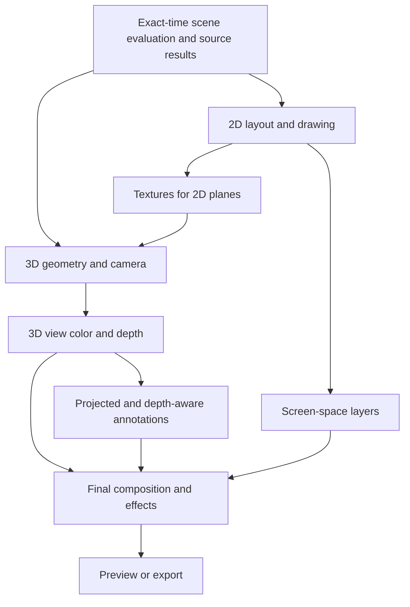

# Targets for mixed 2D and 3D scenes

Status: proposed scope and architecture, 2026-10-26. No 3D runtime or renderer integration is implemented.

## Product target

Support explanatory animation that uses spatial geometry together with typography, diagrams, and deliberate 2D composition. Swaptube's 3D is the functional reference, and the author cites ScienceClic as an art-direction reference. The first Fortran fractal project does not require 3D. A narrow integration proof should nevertheless inform the backend decision.

The first useful 3D scope is mathematical and scientific geometry: animated surfaces, grids, curves, points, arrows, textured planes, and cameras, with readable labels and 2D overlays. Detailed cinematic asset production is not the initial target. The design should leave room for more advanced scientific effects when a project needs them.

The author subsequently supplied six visual references. Their [feasibility breakdown](reference-feasibility.md) identifies the needed capabilities. The [consolidation proposal](rendering-target.md) combines the first curve, plot, and field experiments into one initial acceptance scene: a field lifting into a surface with a curve, colored markers, attached labels, and fixed 2D graphics. The curve is the first implementation step within that scene.

A follow-up crowd reference confirms rigid unrigged people colored by per-person forces. This adds generic mesh instances with per-instance numerical attributes to the planned scientific 3D vocabulary. Crowd simulation remains a user data source; mesh rendering and color mapping remain generic engine capabilities. Population scale and visual polish should be tested separately.

## What the Swaptube reference establishes

The inspected `ThreeDimensionScene` exposes points, lines, a camera, quaternion orientation, and projection from world coordinates to pixels. Its implementation draws point labels at projected positions. Source: [ThreeDimensionScene](https://github.com/2swap/swaptube/blob/master/src/Scenes/Common/ThreeDimensionScene.cpp).

`ManifoldScene` adds parameterized surfaces and texture input; its demo transitions a textured plane into a sphere. A separate volumetric fractal scene/demo exists. This reference includes genuine spatial geometry and procedural rendering, beyond merely rotating a flat picture. Sources: [ManifoldScene](https://github.com/2swap/swaptube/blob/master/src/Scenes/Math/ManifoldScene.h), [manifold demo](https://github.com/2swap/swaptube/blob/master/src/Projects/Demos/ManifoldDemo.cpp), [volumetric demo](https://github.com/2swap/swaptube/blob/master/src/Projects/Demos/VolumetricFractalDemo.cpp).

Use those capabilities and the supplied stills to guide the initial feature set. Select short motion excerpts later where camera behavior or compositing remains ambiguous. No particular production toolchain or reproduction of every original effect is assumed.

## Three kinds of mixing

| Mode | Meaning | Example |
| --- | --- | --- |
| Screen-space composition | 2D elements are laid out over or beside a rendered 3D view | An equation, caption, legend, or inset next to a PDE surface |
| 2D content in world space | A diagram/text panel has a 3D transform and participates in depth | A coordinate sheet, annotation card, or heatmap plane |
| Spatial annotations and geometry | Positions and visibility are tied to the same 3D camera/depth conventions | A label follows a surface probe; an arrow passes behind a surface |

All three use one timeline and source model. They need distinct spatial and rendering semantics. Preserve a normal 2D layout tree for text and panels; explicit embedding places a 2D result into world space.

An RGBA image of a 3D view supports screen-space composition, but it does not retain individual object depth for arbitrary interleaving. Screen `zIndex` orders composition layers. World-space geometry uses depth testing within its view. Define the boundary between these operations explicitly.

## Proposed capability levels

| Level | Scope | Delivery expectation |
| --- | --- | --- |
| First fractal project | Callable/baked numerical field, palettes, typography, layout, and motion | Primary first deliverable; can stay entirely 2D |
| Architecture proof | Simple 3D height field, camera, attached label, and 2D plane with occlusion | Small experiment before fixing the rendering stack |
| Initial scientific 3D | Indexed surfaces, points/curves/arrows, rigid mesh instances with numerical attributes, orthographic/perspective cameras, transforms, basic controlled shading, textured planes, annotations | Planned extension when a project needs 3D |
| Advanced scientific views | 3D slices, isosurfaces, volume ray marching, richer transparency, procedural fields | Add selectively from project requirements |

Opaque meshes and simple transparency are a smaller scope than arbitrary overlapping translucent surfaces or volumes. Keep the latter as explicit later capabilities. Surface clipping/cutaways may require both clipping logic and generated caps; a clipping plane alone does not promise a closed cut surface.

For storytelling, prioritize stable silhouettes, readable line work, deliberate colors, camera choreography, and transitions between representations. Basic unlit/color-mapped and softly shaded materials can cover much of this scope.

## Architecture direction

Prefer one GPU device and coordinated submission for the participating drawing modules. The leading experiment uses wgpu, which provides portable graphics/compute and color/depth render attachments. Sources: [wgpu](https://wgpu.rs/), [render pass attachments](https://docs.rs/wgpu/latest/wgpu/struct.RenderPassDescriptor.html).

Vello is a candidate 2D drawing module in that stack. It remains a 2D renderer; the 3D path needs meshes, projection, depth, materials, and its own rendering logic. Its caller-owned device/encoder API and texture bindings provide a concrete integration point. Source: [Vello GPU wgpu implementation](https://github.com/linebender/vello/blob/main/vello_gpu/src/render/wgpu/mod.rs).

The 3D path can be a focused module we implement, or an adapter to an existing engine such as Bevy. Compare a small complete scene before adopting either. A focused module offers control but makes geometry rendering, antialiasing, clipping, transparency, and scientific effects our engineering responsibility. Bevy supplies substantial existing renderer infrastructure but adds integration and dependency costs.

For a Bevy-based implementation, share the renderer's actual wgpu device and compatible resource types. Its current render integration uses ECS schedules; use the selected version's supported mechanisms rather than older render-graph tutorials. Source: [Bevy render scheduling](https://bevy.org/news/bevy-0-19/#render-graph-as-systems).

Skia remains eligible as the 2D module if an efficient shared-resource path is demonstrated. Its supported native GPU backends can interoperate with external resources, but a portable automatic bridge to a separate wgpu renderer is not established. Budget synchronization, texture formats, and ownership explicitly. Repeated CPU readback between 3D and 2D drawing is unsuitable as the intended normal path.

## Contracts to establish early

- **Views and spaces:** distinguish screen/layout coordinates, local 2D plane coordinates, and 3D world/data coordinates. State handedness, axis directions, units, and transform conventions.
- **Cameras:** separate a view's rectangle/resolution from its orthographic or perspective camera. Define projection and inverse transforms, clipping, and depth conventions.
- **View output:** identify color texture, optional depth texture, extent/sample count, alpha/color encoding, and the camera/viewport metadata needed to interpret them.
- **Resource ownership:** one clear owner for device lifetime, compatible texture usages/formats, synchronization, and allocation reuse. Shared APIs alone do not prove compatible crate versions or devices.
- **Annotations:** choose whether a label stays screen-sized, lies on a plane, or billboards toward the camera. Projected labels declare visibility policy: always visible, hide behind geometry, or show through with a distinct style.
- **Depth:** world geometry and world planes share compatible depth conventions. Renderer-internal 2D depth optimizations are not automatically 3D scene depth.
- **Line width:** distinguish screen-pixel strokes from world-radius curves/tubes; changing camera distance should have predictable effects.
- **Texture quality:** define how embedded vector/text panels select raster resolution, filtering, and cache keys as the camera moves. Avoid treating one fixed-resolution texture as resolution-independent geometry.
- **Color and alpha:** define linear working/compositing behavior and explicit conversion at display/export boundaries. Color-mapped numerical data should retain its intended colors across 2D/3D passes.
- **Time:** cameras, object transforms, source parameters, and annotations sample the same exact timeline time. Frame history effects need reset/reconstruction on seek or remain disabled for deterministic output.

## Data for PDEs

Keep numerical data separate from its presentation. One 2D field can drive a flat heatmap and a 3D height field. A 3D grid can drive selected slices; later geometry extraction or ray marching can provide other views. Coordinate metadata, topology, vertex/cell association, and validity are part of the data contract.

Prefer bulk geometry and field buffers. Updating values should not require rebuilding topology when it is unchanged. Preserve the solver's precision in storage; use an explicit transformation to render coordinates when GPU precision differs. Camera-relative coordinates or local origins may be necessary for large scientific domains.

The Fortran adapter should expose numerical results independently of these choices. A source request may depend on a camera/probe where needed, while a saved world-space PDE solution can be reused as the camera moves.

## Acceptance scene before backend selection

Use the [single-target proposal](rendering-target.md) and tiny synthetic datasets so solver cost does not hide integration issues. Its incremental implementation should cover these spatial checks:

1. Animate an orthographic/perspective camera around a surface with a scalar color map.
2. Put a text/diagram plane into the world and move it partly behind the surface.
3. Attach a screen-sized label to a sample point; demonstrate both always-visible and occlusion-aware visibility.
4. Keep a screen-space equation/legend fixed while the camera moves.
5. Seek directly to sample times and compare against sequential evaluation, with temporal effects accounted for.
6. Keep 2D/3D exchange on the GPU and inspect color, alpha, depth edges, text quality, and direct frame export.
7. Record missing effects and integration work alongside timing; do not select a stack from a rotating-cube benchmark alone.

This experiment validates the intended extension path. It does not make a complete 3D engine a prerequisite for the first fractal video.
